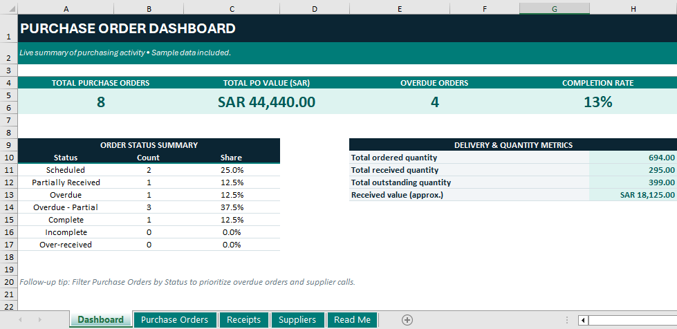
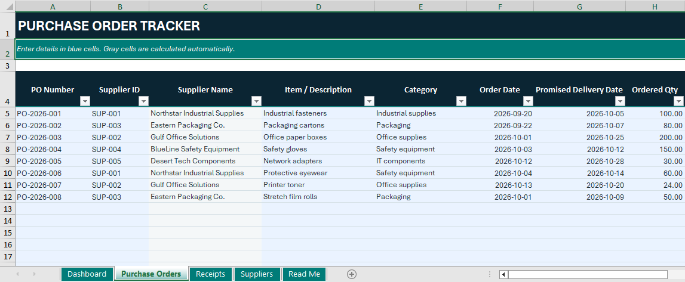
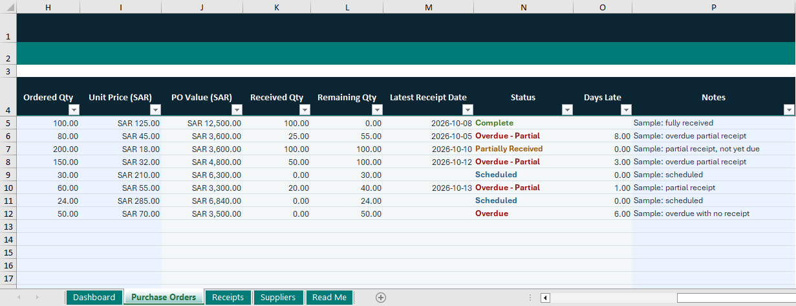
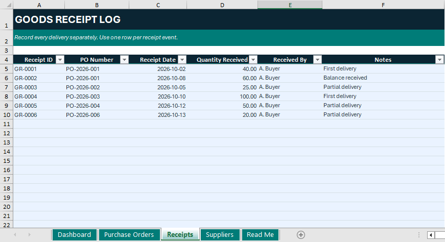
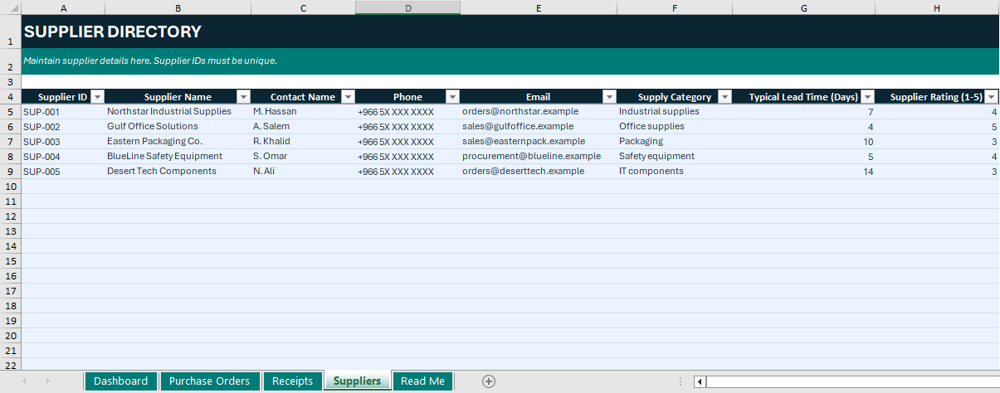

# Purchase Order Tracker | Microsoft Excel

A practical procurement tracking solution built in Microsoft Excel 2019 to help organize purchase orders, monitor supplier deliveries, track outstanding quantities, and identify overdue orders.

Managing purchase orders involves more than recording order details. Procurement teams need visibility into order values, supplier information, delivery commitments, partial receipts, and outstanding quantities. This project brings these activities together in a structured workbook, using automated formulas and a dashboard to support purchasing follow-up and operational monitoring.

**Tools:** Microsoft Excel 2019  
**Domain:** Procurement, Purchasing & Inventory Operations  
**Dataset:** Sample data created for demonstration purposes

---

## 1. Dashboard & Procurement Overview

  

The dashboard provides a consolidated overview of purchasing activity, allowing users to review key indicators and identify orders requiring attention.

It summarizes total purchase orders, total purchase order value in SAR, overdue orders, completion rate, order status distribution, and delivery and quantity metrics.

The sample dashboard reports **8 purchase orders** with a combined value of **SAR 44,440.00**, alongside ordered, received, and outstanding quantity metrics.

## 2. Purchase Order Tracking

  

This section maintains the main purchase order information, including purchase order number, supplier, item description, category, order date, promised delivery date, and ordered quantity.

Supplier names are retrieved using supplier IDs, helping maintain consistent supplier references across the workbook.

  

The tracking section calculates purchase order values, received quantities, remaining quantities, latest receipt dates, order status, and days late.

Predefined status rules distinguish scheduled, partially received, overdue, overdue-partial, complete, incomplete, and over-received orders. Filters and conditional formatting help users identify delayed deliveries and prioritize supplier follow-up.

## 3. Goods Receipt Tracking

  

The Goods Receipt Log records each delivery as a separate transaction and links it to the corresponding purchase order.

This structure supports multiple receipts against a single order. The recorded receipt quantities feed into the Purchase Orders worksheet, where total received and remaining quantities are calculated automatically.

## 4. Supplier Directory

  

The supplier directory maintains supplier IDs, names, contact information, supply categories, typical lead times, and sample supplier ratings.

Supplier IDs connect supplier records to purchase orders, supporting consistent supplier information and easier reference during procurement follow-up.

## 5. Sample Results

The workbook includes eight sample purchase orders and six goods receipt records.

| Metric | Sample Result |
|---|---:|
| Total purchase order value | SAR 44,440.00 |
| Total ordered quantity | 694 |
| Total received quantity | 295 |
| Total outstanding quantity | 399 |
| Approximate received value | SAR 18,125.00 |

These figures reflect the included sample dataset and change when purchase orders, receipts, or delivery information are updated.

## 6. Excel Skills Demonstrated

The project applies Excel formulas and features to automate calculations and support operational reporting:

- **`SUMIF`** — aggregates receipt quantities by purchase order.
- **`INDEX` and `MATCH`** — retrieve supplier names using supplier IDs.
- **`IF` and `IFERROR`** — handle order status logic and formula errors.
- **`MAX`** — supports remaining quantity and days-late calculations.
- **Conditional Formatting** — highlights order statuses visually.
- **Data Filtering** — helps prioritize orders requiring follow-up.
- **Dashboard Reporting** — summarizes purchasing KPIs and delivery metrics.

## 7. How to Use

1. Open the workbook in Microsoft Excel 2019 or a compatible version.
2. Maintain supplier information in the `Suppliers` worksheet, ensuring supplier IDs are unique.
3. Enter purchase order details in `Purchase Orders`.
4. Record each delivery as a separate row in `Receipts`, using the matching purchase order number.
5. Review calculated quantities, delivery status, days late, and dashboard metrics.

Use unique purchase order numbers and receipt IDs, and ensure each receipt references the correct purchase order.

## 8. Scope & Assumptions

This is an Excel-based portfolio project using illustrative sample data. It is designed to demonstrate purchase order monitoring and procurement reporting, rather than replace an integrated ERP or procurement management system.

Supplier contact details and ratings are fictional. The received value is an approximate metric based on sample order prices and received quantities.

## Download the Workbook

[**Download the Purchase Order Tracker (.xlsx)**](./Purchase_Order_Tracker.xlsx)

## Author

**Bandar Al Radhi**

This project demonstrates the application of Microsoft Excel to procurement operations, purchase order monitoring, goods receipt tracking, and delivery follow-up.
